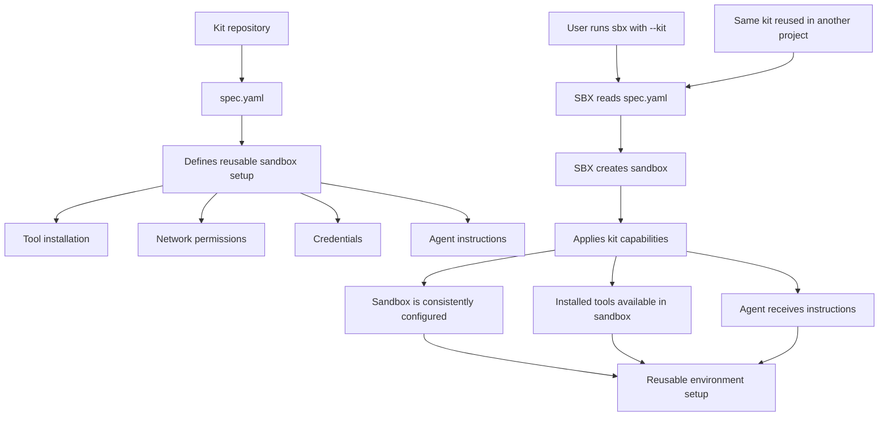

# ACR Docker Sandboxes Kit (v3)

A Docker Sandbox Kit schema **v3** mixin for installing [Agentic Context Registry (ACR)](https://github.com/jbaruch/agentic-context-registry), a package manager for AI coding-agent guidance. ACR can materialize GitHub-hosted rules, skills, scripts, and hooks for agents such as Codex, Claude Code, and Cursor.

This kit installs the ACR CLI in the sandbox, verifies the downloaded release against its published SHA-256 checksums, configures scoped GitHub network access, and supplies agent instructions for synchronizing a project's `agents.yaml` dependencies. **The kit does not create a new AI agent**: the existing coding agent invokes ACR as a tool.

## Attribution and changes from upstream

This repository is a modified version of the original [ACR SBX Kit](https://github.com/shelajev/acr-sbx-kit) by **shelajev and the ACR SBX kit contributors**. The original uses Sandbox Kit schema v2. This fork adapts it to schema v3 so it can compose with v3 workloads and mixins.

Changes in this fork:

- Migrated `schemaVersion: "2"` to `schemaVersion: "3"`, removing the obsolete top-level `name` field.
- Replaced v2 `permissions.network`, `credentials`, `setup.install`, and `agentInstructions` with v3 capabilities.
- Split network access into installation and runtime phases and updated GitHub bearer-credential injection syntax.
- Retained ACR version pinning, checksum verification, optional GitHub authentication, and agent bootstrap instructions.

The original authorship and Apache License 2.0 notices are retained. This is an **unofficial fork**, not a release maintained by the original author. See [LICENSE](LICENSE).

## How kits enable reusable sandbox capabilities




## Requirements

- Docker Sandboxes (`sbx`) with **v3 kit support**.
- A Docker Sandboxes agent workload such as `codex`.
- Access to the required GitHub hosts (subject to your sandbox's policy).

The default ACR release is **`0.2.1`**. It is downloaded for the sandbox's Linux architecture (`amd64` or `arm64`) when a new sandbox is created.

## Usage

### 1. Allow this GitHub publisher (HOST)

Check your existing allowlist:

```bash
sbx settings get kit.allowedSources
```

If the list contains only `docker.io/`, run:

```bash
sbx settings set kit.allowedSources '["docker.io/","github.com/yjrd21/"]'
```

**Preserve any existing publishers** when updating the list. In particular, don't remove `github.com/shelajev/` if you still use other workshop kits from that source. Only authorize publishers you trust.

### 2. Run from GitHub (HOST)

From the directory of the project you want to mount:

```bash
sbx run codex "$(pwd)" \
  --name sbx-acr \
  --skills off \
  --kit 'git+https://github.com/yjrd21/acr-dockersbx-kit.git#ref=main'
```

For reproducible environments, use a **tested release tag or complete commit SHA** instead of `main`. This ensures the kit won't silently change when new commits are pushed.

### 3. Alternatively, run from a local checkout (HOST)

```bash
git clone https://github.com/yjrd21/acr-dockersbx-kit.git
cd acr-dockersbx-kit
sbx kit validate .
```

From inside that checkout, launch Codex against your **actual target project** (replace `/absolute/path/to/project`):

```bash
sbx run codex /absolute/path/to/project \
  --name sbx-acr \
  --skills off \
  --kit .
```

Do not assume the target project is inside the kit's repository. The `--kit .` argument refers to the current kit checkout, while the positional path refers to the workspace mounted for the agent.

### UBS workshop: compose with your hello-kit (HOST)

From the `ubs-sbx-workshop` root, after configuring allowed sources:

```bash
sbx run codex "$(pwd)/sample-app" \
  --name sbx-guidance \
  --skills off \
  --cpus 4 \
  --memory 8g \
  --kit ./factory/hello-kit \
  --kit 'git+https://github.com/yjrd21/acr-dockersbx-kit.git#ref=main'
```

Both kits must be v3-compatible. If `sbx-guidance` already exists, exit the agent and remove that sandbox before recreating it (`sbx rm sbx-guidance`).

## Using ACR inside the sandbox

Verify the executable was installed:

```bash
acr version
acr help install
```

To add an ACR package to a project that does not yet declare one:

```bash
acr install github:OWNER/REPO \
  --agent codex \
  --freshness outdated \
  --non-interactive
acr realize
```

For the workshop's public coding policy, follow the **exact pinned package and command** in [the upstream workshop instructions](https://github.com/shelajev/ubs-sbx-workshop/blob/main/workshop/03-kits.md), Section 3.

When a project already contains `agents.yaml`, the kit instructs Codex to run:

```bash
acr install --non-interactive
acr realize
```

These are **agent instructions**, not an unconditional startup script. The agent must actually follow the guidance and execute them. `acr install` reconciles declared dependencies; `acr realize` writes agent-facing guidance and skills. Review changes to `agents.yaml`, `.agents/registry.lock`, and the generated agent files before committing them. A restart may be necessary for newly installed skills or hooks to be discovered.

## GitHub credentials and network access

A GitHub token is **optional** for public packages. For private packages, higher API limits, or publishing, the kit declares an optional `acr-github` credential service. If configured through Docker Sandboxes, the sandbox receives a proxy-managed placeholder as `GH_TOKEN`; the real secret stays in the host-side credential service and is injected only for permitted requests to `api.github.com`, `codeload.github.com`, and `uploads.github.com`.

The network policy allows these hosts:

| Phase | Allowed hosts |
| --- | --- |
| Install | `github.com`, `release-assets.githubusercontent.com`, `objects.githubusercontent.com` |
| Runtime | `github.com`, `release-assets.githubusercontent.com`, `api.github.com`, `codeload.github.com`, `objects.githubusercontent.com`, `uploads.github.com` |

The install-phase policy is for downloading ACR itself. The runtime policy is for the agent's ACR package operations. Other kits in a composition may contribute additional network permissions.

## Verification and troubleshooting

From the kit checkout on the HOST:

```bash
sbx kit validate .
sbx kit inspect . --json
```

Then create a fresh sandbox and ask Codex to run `acr version`. To exercise more than installation, follow the UBS workshop's ACR policy installation and `acr realize` steps.

If you receive **"cannot mix v3 kits with v1/v2 kits"**, verify that your command points to **this fork**, not `shelajev/acr-sbx-kit`, and that your hello-kit is v3.

If the kit fails at installation, check whether the configured GitHub release hosts are accessible and whether the specified ACR release has assets for your sandbox architecture.

**Status:** This configuration is adapted to the published v3 specification. It should be validated and smoke-tested using your installed SBX version before treating it as a verified release.

## License

Apache License 2.0; see [LICENSE](LICENSE). This fork preserves the original ACR SBX kit contributors' attribution. The upstream project is available at [shelajev/acr-sbx-kit](https://github.com/shelajev/acr-sbx-kit).
